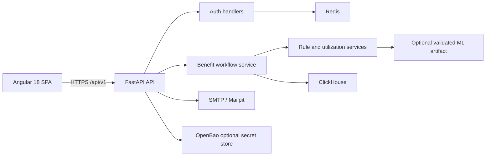

# BenefitIQ

## Business purpose

BenefitIQ helps a card issuer and its cardholders understand which entitled benefits remain unused. It models card products, benefits, eligibility rules, transactions, redemptions, enrolments and notifications, then presents a member dashboard and restricted administrative portfolio view. The repository is a prototype; its sample data and any displayed amounts are synthetic.

## Current capabilities

- Password, OTP and OAuth sign-in flows with Argon2 password hashes, short-lived JWT access tokens and Redis-backed rotating refresh tokens.
- Customer-scoped card registration, transaction ingestion, reversal, self-reported benefit use and enrolment recording.
- A deterministic rule evaluator for benefit eligibility and a utilization calculation using decimal money values, currency boundaries and half-open benefit cycles.
- Customer benefit summaries, recommendations, nudge acknowledgement and an administrator KPI view.
- A reproducible, optional XGBoost training/scoring pipeline that requires labelled input and records data hashes and validation metadata. It does not claim a production accuracy result.
- Angular 18 member, authentication and administration interfaces. Components use API services rather than embedding HTTP calls.

## User workflows

1. A member logs in and confirms a one-time password delivered through the configured SMTP service.
2. The member sees only cards, transactions, utilization, nudges and enrolments associated with the authenticated identity.
3. The member adds an existing product, imports a transaction, records a redemption or enrolment, and returns to the dashboard to see recalculated usage.
4. An administrator, authorized by role, can view portfolio KPIs, users and configuration metadata. Secret management endpoints are restricted to a fixed application allow-list.

## Architecture

The backend follows an API/application/domain/infrastructure split. API routers validate requests and authenticate callers. Application services orchestrate workflows. Domain entities and value objects hold benefit rules, currency-safe values and periods. ClickHouse, Redis, SMTP, OpenBao and ML artifact loading are infrastructure adapters. The Angular application separates feature components from authentication, customer and administrator API services.

## Frontend/backend interaction

All frontend requests use `/api/v1` through the local development proxy. The authentication service retrieves the backend public key for browser-side encryption, then calls login, OTP verification, refresh and logout endpoints. The customer service accesses only `/analytics/me/*` endpoints. The backend derives the customer identity from the token rather than accepting a client-controlled customer id. Administrative routes enforce administrator authorization.

## Technology stack

| Area | Technology |
|---|---|
| Frontend | Angular 18, TypeScript, Angular Material, RxJS |
| API | Python, FastAPI, Pydantic, Dependency Injector |
| Authentication | Argon2, JWT, Redis refresh tokens, OTP, OAuth/OIDC adapters |
| Data | ClickHouse and Redis |
| Messaging/email | SMTP; Mailpit for local development |
| Secrets | OpenBao-compatible HTTP adapter |
| ML | Optional XGBoost, NumPy and scikit-learn |
| Local services | Docker Compose |

## Data design

Core records include `users`, roles, card products, cards, benefits, benefit rules, card-product links, transactions, benefit usage, enrolments, offers, nudges, model metadata and predictions. Monetary fields are `Decimal`; benefit summary values are always scoped to one ISO currency. Benefit cycles use `[start, end)` boundaries. Transactions and redemptions have external IDs to support idempotent ingestion.

## Implementation status and limitations

The API, member workflow and dashboard are functional for local synthetic data. The repository does **not** include issuer integrations, verified entitlement terms, a production notification provider, consent management, a real claims workflow, data retention policies, audit export, dashboards for measured experiments, or a validated ML artifact. SMTP and OpenBao are adapters; their production deployment and policies are outside this repository.

ClickHouse is well suited to analytical reads, but it is not an OLTP system with transactional guarantees for identities, refresh-token records, redemptions or financial event ingestion. A production deployment should move mutable security and workflow state to PostgreSQL (or equivalent), retain ClickHouse for analytical projections, and use an outbox/event consumer for projection updates.

The configuration service is an administrative capability and currently has a legacy database fallback for values marked secret. Do not store production secrets through that fallback. Use environment-managed credentials or a fully configured OpenBao deployment until the fallback is removed and migrated.

## Prioritized roadmap

1. Move transactional identity and workflow writes to a relational database, add migrations and idempotency constraints, then project analytics to ClickHouse.
2. Integrate authoritative issuer benefit terms, transaction feeds and redemption/claim partners; add contract tests and reconciliation.
3. Add tenant isolation, consent preferences, immutable audit events, retention/deletion policies, key rotation and security monitoring.
4. Replace local SMTP and development OTP delivery with an approved provider; add rate-limit observability and abuse controls at the edge.
5. Build a labelled experiment dataset and only deploy a model after offline validation, fairness review, calibration and monitored online evaluation.
6. Add browser end-to-end tests, accessibility checks, dependency scanning and production deployment manifests.
